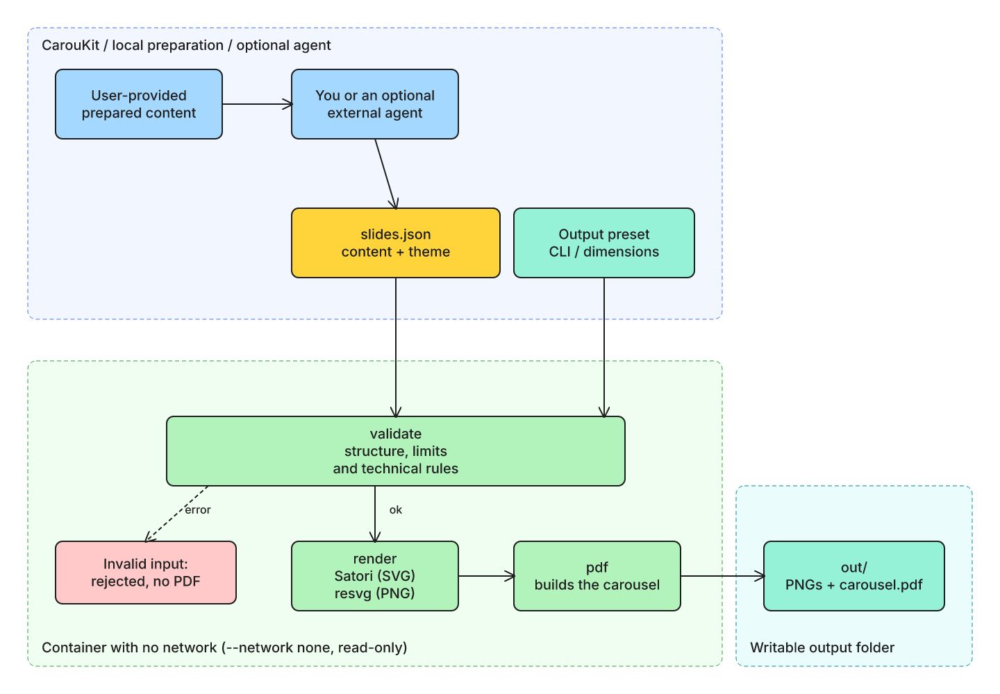

# CarouKit


English | [Português](README.md)


**Turn your content into carousels.**

Open-source carousel generator. Turn your content into PNG slides and PDF with local rendering, a CLI, and Claude Code integration.

You prepare the content. CarouKit arranges the slides and generates images and a PDF to share. The CLI works without an agent or AI provider; Claude Code is an optional integration. Rendering runs locally in a container without network or browser.

> This branch contains **CarouKit (plugin 1.2.0)**. The remote repository is `lpalvess/caroukit`, recreated at the owner’s request with clean public history. See [compatibility and migration](docs/migration-caroukit.md), [presets and documented requirements](docs/presets.md), and [delivery verification](docs/verification-caroukit.md). Factual checking removed in 1.1 remains removed; `--facts` has an [explicit migration warning](docs/migration-1.1.md). Earlier reports are historical. Internal specifications and plans are kept locally only.

## What it does and does not do

- It validates only technical things: JSON structure, size limits, forbidden characters and text legibility on the slides.
- It does not compare numbers, does not require sources, quotes or a facts file, does not research or browse the internet and does not use AI to fact-check.
- It does not certify that the content is true. **Review the content before you publish**: numbers, names, quotes and credits are the responsibility of whoever provides the text.
- A source or author credit (`source`, footer of up to 80 characters) is optional and is your own text: it is not verified.
- It never publishes, sends or schedules anything. The output is local files.

## Architecture



Inside the container, with no network, `validate` checks the technical rules. If everything passes, `render` draws the slides (Satori for SVG, resvg for PNG) and `pdf` builds the carousel in the output folder. This is the only persistent writable folder; `/tmp` is temporary and discarded with the container. `render` always validates first.

The editable diagram files are in [docs/diagrams/](docs/diagrams/): `architecture.en.excalidraw` (opens at excalidraw.com) and `architecture.en.drawio` (opens in draw.io).

## First use

You need Docker and a Bash shell. On Windows, use WSL with Docker integration turned on. Setup, validation, render and selftest were verified on 2026-11-12 on Ubuntu 24.04 via WSL2, with Docker and the pinned project image. Native Windows and macOS were not verified. See the [previous 1.1 evidence](docs/verification-1.1.md) and [CarouKit evidence](docs/verification-caroukit.md).

```
git clone --branch feat/prepared-content --single-branch https://github.com/lpalvess/caroukit.git caroukit
cd caroukit
scripts/carousel.sh setup      # installs dependencies in the container; the only step with network
scripts/carousel.sh selftest   # recommended: proves the container has no network and cannot write outside the output
```

Generate the six-slide example, copy the JSON to your own file and edit it:

```
scripts/carousel.sh render examples/slides.json --out out/example
mkdir -p my-carousels
cp examples/slides.json my-carousels/post-1.json
# edit my-carousels/post-1.json with your content
scripts/carousel.sh render my-carousels/post-1.json --out my-carousels/post-1-output
```

Then **open all the PNGs** to check that nothing is cut off or unreadable, and only then use `carousel.pdf`. Because `render` validates first, running `validate` beforehand is optional (a diagnostic):

```
scripts/carousel.sh validate my-carousels/post-1.json
```

Normal commands do not use `--facts`.

### Output folder

- Without `--out`, the folder is `out`, relative to the folder you ran the command from (not the plugin root). Always prefer an explicit `--out`.
- On success, the wrapper prints the absolute path of the output folder.
- The wrapper prepares this folder before validation; a failure may leave an empty folder.
- Known generated filenames are replaced; unrelated files are preserved. Prefer a dedicated folder per carousel.

### Optional Claude Code integration

To try this branch after cloning and installing dependencies, load the plugin for one session:

```
claude --plugin-dir "$PWD"
```

Or install this branch's marketplace:

```
claude plugin marketplace add lpalvess/caroukit#feat/prepared-content
claude plugin install caroukit@caroukit
```

The `/caroukit:caroukit` skill takes your content, arranges a slide plan, validates, generates and asks you to review the images. An already approved plan proceeds. It never publishes. See [SKILL.md](SKILL.md) and [migration for old installations](docs/migration-caroukit.md).

Installation requires network (GitHub, Docker image and pinned packages). Claude Code can also install frozen dependencies without scripts when Bun is available, as described in its [documentation](https://code.claude.com/docs/en/plugins/loading). Using the agent may send conversation content to its provider. Only validation and rendering inside the container are offline. The CLI does not depend on Claude; the integration does not run in claude.ai chat.

## The example

`examples/slides.json` is FICTIONAL: an invented company and invented numbers. The example text is in Portuguese. Expected output:

- `validate`: `ok: 6 slides passed technical validation` and exit code 0.
- `render`: `slide 1/6` through `slide 6/6`, six PNGs (`01-hook.png`, `02-number.png`, and so on) and a six-page `carousel.pdf`, a short note asking for review before publishing and, last, the absolute path of the folder.

The same example in the light theme and the portrait format (`"meta": { "theme": "light", "format": "linkedin-portrait" }`):


The images are the tool's real output on `examples/`, laid out on a page and captured with Playwright in a container without network. Playwright is not part of the project.

## Destination and dimensions

Content (`slides.json`), layout (`meta.theme`, `meta.accent` and six slide types), and output preset are separate. Every run recomposes text, fonts and spacing at the final size.

| Preset | Canvas | Primary file |
| --- | --- | --- |
| `instagram` | 1080×1350 | PNG sequence |
| `tiktok` | 720×1280 | PNG sequence; organic compatibility untested |
| `linkedin` | 1080×1350 | Document PDF |
| `generic` | 1080×1080, configurable | PNGs and PDF |

All presets generate PNG previews and PDF so you can inspect images before using the export:

```
scripts/carousel.sh render examples/tutorial.json --preset instagram --out out/tutorial
scripts/carousel.sh render examples/educational.json --preset tiktok --out out/educational
scripts/carousel.sh render examples/project.json --preset linkedin --out out/project
scripts/carousel.sh render examples/project.json --preset generic --size 1440x1080 --out out/generic
```

Without output options, `meta.format` still works. `--preset` overrides that legacy format. `--size` alone selects `generic`; custom sizes cannot be combined with platform presets. Internal safety bounds: integer edges 540–2160 px, at most 2,500,000 pixels per slide, aspect ratio 1:2 through 2:1, and 3–10 slides. These are product safety bounds, not platform limits.

Generated files, documented requirements, and actual publication are distinct evidence levels. No actual post was tested. TikTok uses a size referenced in advertising documentation and makes no organic-photo compliance claim. See [official sources and limitations](docs/presets.md).

## Slide types

`slides.json` has an optional `meta` and `slides`, from 3 to 10. Every slide accepts `source` (an optional footer credit, text of up to 80 characters) and `highlight` (1 or 2 words from the slide itself, drawn in the accent color).

| type | Required fields | Notes |
| ---- | --------------- | ----- |
| `hook` | `text` | Up to 3 lines. Opening slide. |
| `text` | `title`, `text` | `text` up to 40 words. |
| `number` | `value`, `label` | `value` is the big figure, such as `42%`. |
| `list` | `title`, `items` | 1 to 6 items. |
| `quote` | `text`, `author` | A quotation. |
| `cta` | `text`, `handle` | Closing slide. |

`meta` accepts `theme` (`dark`, the default, or `light`), `format` (`linkedin-square` 1080x1080, the default, or `linkedin-portrait` 1080x1350) and `accent` (a `#RRGGBB` color).

## Validator rules

Each finding is printed as `<severity> slide <N> <rule-id>: <message>`. On success, the output is `ok: N slides passed technical validation`.

| ID | Severity | What it rejects |
| -- | -------- | --------------- |
| `schema-invalid` | error | Invalid JSON, structure outside the schema, or invalid `meta`. |
| `type-unknown` | error | A slide with no `type` or an unknown type. |
| `field-missing` | error | A required field of the type is missing, or `items` is outside 1 to 6. |
| `slide-count` | error | Fewer than 3 or more than 10 slides. |
| `too-many-words` | error | `text` of a `text` slide with more than 40 words. |
| `hook-too-long` | error | A `hook` with more than 3 lines. |
| `highlight-invalid` | error | An empty `highlight`, one with more than 2 words, or one that does not appear in the slide. |
| `source-too-long` | error | A `source` with more than 80 characters. |
| `forbidden-char` | error | An em dash, an en dash, other dashes (U+2012, U+2015, U+FE58, U+FF0D), any arrow from the Unicode arrow blocks, and the sequences `->`, `=>` and `<-`, in any text. A plain hyphen and the minus sign (U+2212) are allowed. |
| `structure` | warning | The first slide is not a `hook` or the last is not a `cta`. |

The rules `number-not-in-facts`, `facts-skipped` and `non-ascii-digit` were removed in 1.1.0 (see the [migration guide](docs/migration-1.1.md)).

## Exit codes

| Code | Meaning |
| ---- | ------- |
| 0 | No errors (warnings do not count). |
| 1 | Validation error. |
| 2 | Wrong arguments, unreadable file or path, or dependencies not installed. Also when `--facts` has no value or gets another option as its value. |
| 3 | Render failure (render, pdf or write step), including `text-overflow`. No `carousel.pdf` is written when a `render` with valid input fails. |
| 4 | The container could not be started (for example, Docker is missing). |

Docker's own runtime errors may surface with Docker's exit code (such as 125), outside the table above. `text-overflow` uses code 3: shorten the slide text.

## Troubleshooting

| Symptom | What to do |
| ------- | ---------- |
| "docker is required" (code 4), or another Docker error (for example, code 125) | Install Docker and check that it is running with `docker info`. On WSL, check the Docker integration. |
| Code 2 and "dependencies are not installed" | Run `scripts/carousel.sh setup` (the only step with network). Run it again after you update the plugin. |
| Code 2 with a message about a path or file | Check the path of `slides.json` and of the output folder (no comma or newline in the path). |
| Code 1 | Read each `error slide N rule: message` line, fix `slides.json` and validate again. |
| Code 3 or `text-overflow` | The text does not fit even at the minimum size: shorten the slide text. No PDF is written. |
| `too-many-words` or `hook-too-long` | Shorten the slide text. |
| PNGs you do not recognize in the output | Unrelated files are preserved. Use a dedicated folder per carousel. |

## Support

- Questions and problems: open an issue at https://github.com/lpalvess/caroukit/issues.
- Security problems: use private vulnerability reporting, as [SECURITY.md](SECURITY.md) explains.
- Want to contribute: see [CONTRIBUTING.md](CONTRIBUTING.md).
- Usage pilot (proposed, not yet conducted): [docs/pilot.md](docs/pilot.md).

## Security

What the project guarantees, by construction:

- Validate and render run in a container with `--network none`: no network at run time, no telemetry.
- The code is mounted read-only, the root filesystem is read-only, all Linux capabilities are dropped, and persistent writes are restricted to the output directory. `/tmp` uses a disposable 128 MB tmpfs with `noexec,nosuid`.
- No browser is used. Drawing is done with Satori and resvg-wasm.
- The input is JSON read as data and never executed, and all text is drawn as text.
- 2 direct runtime dependencies (`satori` and `@resvg/resvg-wasm`), with exact versions. Installation uses a frozen lockfile with install scripts disabled. Details in [docs/dependencies.md](docs/dependencies.md).
- The container base image is pinned by digest.

What the project does NOT guarantee:

- That the content is true, correct or suitable for publication. The review is yours.
- That the text in the PDF is selectable. Pages are images.
- The security of Docker itself. The isolation depends on Docker and on your system.

### Reproducibility

`tests/e2e.test.ts` compares the output of two process runs byte for byte. This holds for the same image digest, the same CPU architecture, the same lockfile, the same code and fonts and the same input JSON. There is no guarantee across different platforms or architectures, and setting `CAROUSEL_IMAGE` changes the environment.

## Known limitations

- Text in the PDF becomes an image and is not selectable.
- Text fitting is a conservative estimate. If the text does not fit even at the minimum size, render fails with `text-overflow`.
- A 3-line hook may wrap onto more lines when rendered. Check the PNGs.
- Four output presets, safety-bounded generic dimensions and two themes.
- The validator does not check the content: numbers, names, quotes and source or author credits are your own text, unverified.
- The static security test in `tests/security-static.test.ts` is a pattern heuristic over `src/`. The real defense is the container without network.
- Native Windows and macOS were not verified.

## What this project does not do

- It does not write the post text.
- It does not publish, send or schedule to any social network.
- It does not research sources or verify facts.
- It has no visual editor.
- It does not generate images with AI and does not place images on slides.

## Similar projects

Other projects that also generate carousels and may fit your case better:

- [ContentHub](https://github.com/thallisribeiro/contenthub): generates content and carousels for Instagram.
- [threads-carousel-claude-skill](https://github.com/itchernetski/threads-carousel-claude-skill): a Claude Code skill that turns posts into carousels, with a browser preview. It inspired this project.
- [linkedin-carousel-gen](https://github.com/Slashgear/linkedin-carousel-gen): generates LinkedIn carousel PDFs with Satori and Bun.

## License and credits

- Code under the MIT license, see [LICENSE](LICENSE).
- Privacy policy: [PRIVACY.md](PRIVACY.md).
- Inter font, OFL license, see [THIRD_PARTY_FONTS.md](THIRD_PARTY_FONTS.md).
- Diagrams made with [Excalidraw](https://excalidraw.com) and the [drawio-skills](https://github.com/bahayonghang/drawio-skills) skill (MIT).
- Satori and resvg-wasm are MPL-2.0 and used without modification. See [docs/dependencies.md](docs/dependencies.md).
