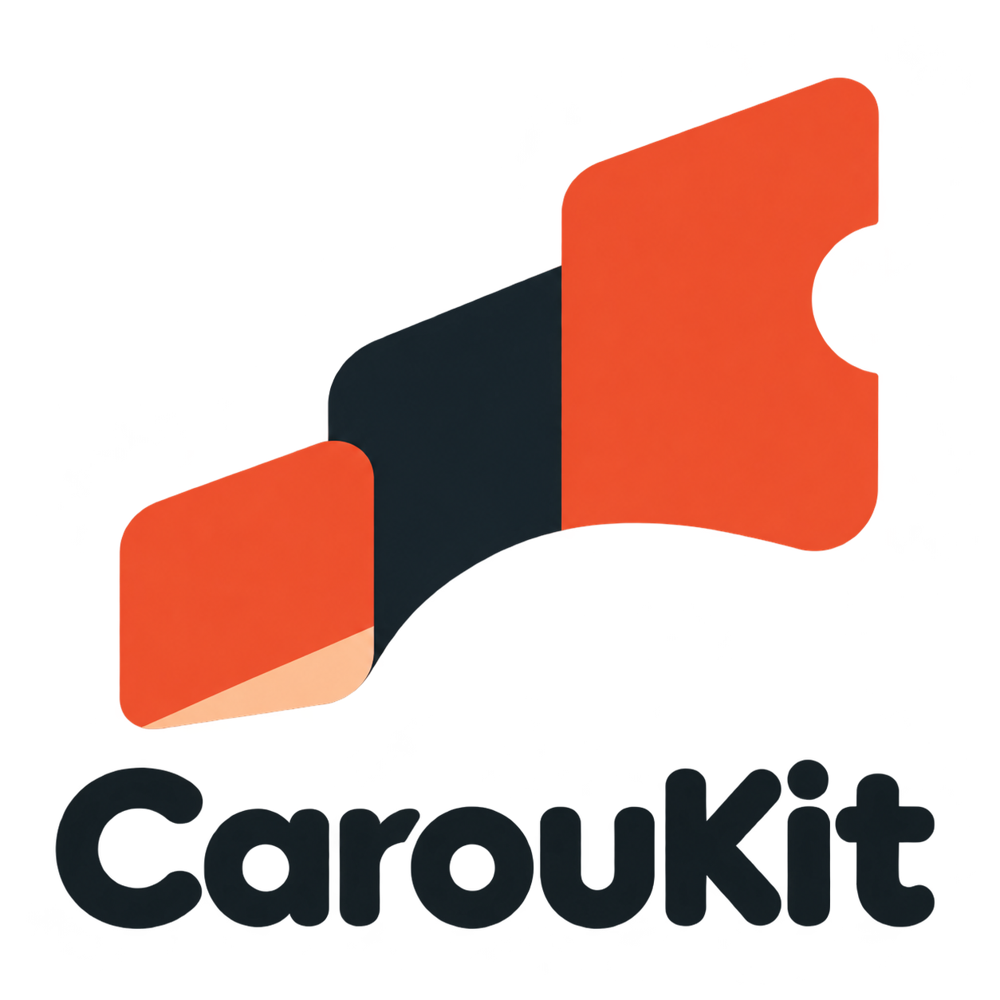
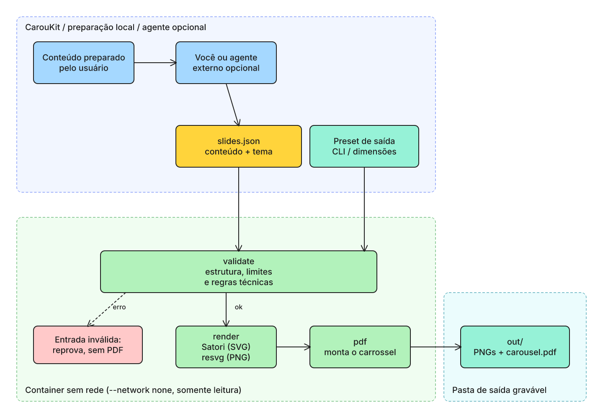
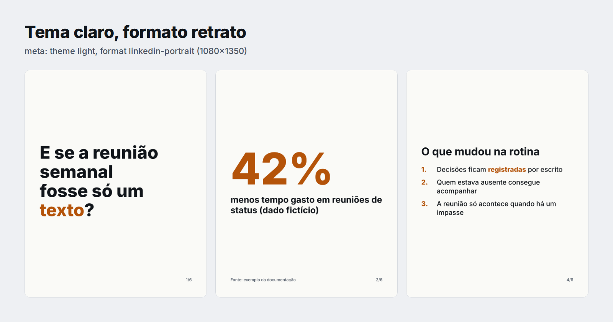

# CarouKit



[English](README.en.md) | Português


**Transforme seu conteúdo em carrosséis.**

Você prepara o conteúdo. O CarouKit organiza os slides e gera as imagens e o PDF para compartilhar.

Gerador de carrosséis open source, independente de rede social. A CLI funciona sem agente ou provedor de IA. A integração com Claude Code é opcional. O desenho dos slides acontece localmente, em container sem rede e sem navegador.

> Esta branch contém a migração para **CarouKit (plugin 1.2.0)**. O repositório remoto é `lpalvess/caroukit`, recriado por solicitação do proprietário com histórico público limpo. Veja [compatibilidade e migração](docs/migration-caroukit.md), [presets e requisitos documentados](docs/presets.md) e [verificações desta entrega](docs/verification-caroukit.md). A checagem factual removida na 1.1 permanece removida; `--facts` tem [aviso explícito de migração](docs/migration-1.1.md). Os relatórios anteriores são históricos. Especificações e planos internos são mantidos apenas localmente.

## O que faz e o que não faz

- Valida só o que é técnico: estrutura do JSON, limites de tamanho, caracteres proibidos e campos suportados. O render verifica o encaixe estimado do texto.
- Não compara números, não exige fontes, citações nem arquivo de fatos, não pesquisa nem navega na internet e não usa IA para checar fatos.
- Não certifica que o conteúdo é verdadeiro. **Revise o conteúdo antes de publicar**: números, nomes, citações e créditos são responsabilidade de quem fornece o texto.
- Crédito de fonte ou autoria (`source`, rodapé de até 80 caracteres) é opcional e é texto seu: não é verificado.
- Nunca publica, envia nem agenda nada. A saída são arquivos locais.

## Arquitetura



Dentro do container, sem rede, `validate` confere as regras técnicas. Se tudo passa, `render` desenha os slides (Satori para SVG, resvg para PNG) e `pdf` monta o carrossel na pasta de saída. Essa é a única pasta persistente gravável; `/tmp` é temporário e descartado com o container. O `render` sempre valida primeiro.

Os arquivos editáveis do diagrama ficam em [docs/diagrams/](docs/diagrams/): `architecture.pt.excalidraw` (abre em excalidraw.com) e `architecture.pt.drawio` (abre no draw.io).

## Primeiro uso

Precisa de Docker e de um shell Bash. No Windows, use o WSL com a integração do Docker ligada. Setup, validação, render e selftest foram verificados em 2026-11-12 no Ubuntu 24.04 via WSL2, com Docker e a imagem fixada do projeto. Windows e macOS nativos não foram verificados. Os resultados da etapa anterior estão em [1.1](docs/verification-1.1.md); os desta entrega em [CarouKit](docs/verification-caroukit.md).

```
git clone --branch feat/prepared-content --single-branch https://github.com/lpalvess/caroukit.git caroukit
cd caroukit
scripts/carousel.sh setup      # instala as dependências no container; único passo com rede
scripts/carousel.sh selftest   # recomendado: prova que o container não tem rede e não escreve fora da saída
```

Gere o exemplo de seis slides, copie o JSON para um arquivo seu e edite:

```
scripts/carousel.sh render examples/slides.json --out out/exemplo
mkdir -p meus-carrosseis
cp examples/slides.json meus-carrosseis/post-1.json
# edite meus-carrosseis/post-1.json com o seu conteúdo
scripts/carousel.sh render meus-carrosseis/post-1.json --out meus-carrosseis/post-1-saida
```

Depois **abra todos os PNGs** para ver se nada ficou cortado ou ilegível, e só então use o `carousel.pdf`. Como o `render` valida primeiro, rodar `validate` antes é opcional (serve de diagnóstico):

```
scripts/carousel.sh validate meus-carrosseis/post-1.json
```

Comandos normais não usam `--facts`.

### Pasta de saída

- Sem `--out`, a pasta é `out`, relativa à pasta em que você rodou o comando (não à raiz do plugin). Prefira sempre `--out` explícito.
- Ao terminar com sucesso, o wrapper imprime o caminho absoluto da pasta de saída.
- O wrapper prepara essa pasta antes da validação; uma falha pode deixar uma pasta vazia.
- Arquivos gerados com os nomes conhecidos do produto são substituídos; arquivos alheios são preservados. Prefira uma pasta dedicada por carrossel.

### Integração opcional com Claude Code

Para experimentar esta branch, após clonar e instalar as dependências, carregue o plugin só nesta sessão:

```
claude --plugin-dir "$PWD"
```

Ou instale o marketplace desta branch:

```
claude plugin marketplace add lpalvess/caroukit#feat/prepared-content
claude plugin install caroukit@caroukit
```

A skill `/caroukit:caroukit` recebe seu conteúdo, organiza um plano de slides, valida, gera e pede a revisão das imagens. Se o plano já foi aprovado, prossegue. Não publica. Consulte [SKILL.md](SKILL.md) e a [migração de instalações antigas](docs/migration-caroukit.md).

Instalar requer rede (GitHub, imagem Docker e pacotes fixados). O Claude Code também pode instalar dependências congeladas sem scripts quando Bun está disponível, conforme sua [documentação](https://code.claude.com/docs/en/plugins/loading). Usar o agente pode enviar o conteúdo da conversa ao provedor. Somente validar e renderizar no container são offline. A CLI não depende de Claude; a integração não funciona no chat do claude.ai.

## O exemplo

`examples/slides.json` é FICTÍCIO: uma empresa inventada e números inventados. Saída esperada:

- `validate`: `ok: 6 slides passed technical validation` e código 0.
- `render`: `slide 1/6` até `slide 6/6`, seis PNGs (`01-hook.png`, `02-number.png` e assim por diante) e `carousel.pdf` com seis páginas, uma nota curta pedindo revisão antes de publicar e, por fim, o caminho absoluto da pasta.

O mesmo exemplo no tema claro e no formato retrato (`"meta": { "theme": "light", "format": "linkedin-portrait" }`):



As imagens são a saída real da ferramenta sobre `examples/`, montadas numa página e capturadas com Playwright em um contêiner sem rede. O Playwright não faz parte do projeto.

## Destino e dimensões

Conteúdo (`slides.json`), layout (`meta.theme`, `meta.accent` e os seis tipos) e preset de saída são independentes. Cada execução recompõe texto, fontes e espaçamento na dimensão final.

| Preset | Canvas | Arquivo principal |
| --- | --- | --- |
| `instagram` | 1080×1350 | Sequência de PNGs |
| `tiktok` | 720×1280 | Sequência de PNGs; compatibilidade orgânica não testada |
| `linkedin` | 1080×1350 | PDF para documento |
| `generic` | 1080×1080, configurável | PNGs e PDF |

Todos geram PNGs e PDF, permitindo conferir as imagens antes de usar a exportação. Exemplo:

```
scripts/carousel.sh render examples/tutorial.json --preset instagram --out out/tutorial
scripts/carousel.sh render examples/educational.json --preset tiktok --out out/educativo
scripts/carousel.sh render examples/project.json --preset linkedin --out out/projeto
scripts/carousel.sh render examples/project.json --preset generic --size 1440x1080 --out out/generico
```

Sem opções de saída, `meta.format` continua funcionando. `--preset` tem precedência sobre esse formato legado. `--size` sozinho seleciona `generic`; não combine tamanho personalizado com preset de plataforma. Limites internos: lados inteiros entre 540 e 2160 px, até 2.500.000 pixels por slide, proporção de 1:2 a 2:1 e 3–10 slides. São limites de segurança do produto, não limites das redes.

Arquivos gerados, requisitos documentados e publicação real são níveis distintos. Nenhuma postagem real foi testada. O preset TikTok usa uma dimensão de referência de anúncios; não afirma conformidade para fotos orgânicas. Consulte as [fontes oficiais e limitações](docs/presets.md).

## Tipos de slide

O `slides.json` tem `meta` (opcional) e `slides`, de 3 a 10. Todo slide aceita `source` (crédito opcional no rodapé, texto de até 80 caracteres) e `highlight` (1 ou 2 palavras do próprio slide, na cor de destaque).

| type | Campos obrigatórios | Observações |
| ---- | ------------------- | ----------- |
| `hook` | `text` | Até 3 linhas. Abertura. |
| `text` | `title`, `text` | `text` com até 40 palavras. |
| `number` | `value`, `label` | `value` é o número grande, como `42%`. |
| `list` | `title`, `items` | 1 a 6 itens. |
| `quote` | `text`, `author` | Citação. |
| `cta` | `text`, `handle` | Fechamento. |

`meta` aceita `theme` (`dark`, padrão, ou `light`), `format` (`linkedin-square` 1080x1080, padrão, ou `linkedin-portrait` 1080x1350) e `accent` (cor `#RRGGBB`).

## Regras do validador

Cada achado sai como `<severity> slide <N> <rule-id>: <mensagem>`. Em caso de sucesso, a saída é `ok: N slides passed technical validation`.

| ID | Severidade | O que reprova |
| -- | ---------- | ------------- |
| `schema-invalid` | erro | JSON inválido, estrutura fora do schema ou `meta` inválido. |
| `type-unknown` | erro | Slide sem `type` ou com tipo desconhecido. |
| `field-missing` | erro | Falta campo obrigatório do tipo, ou `items` fora de 1 a 6. |
| `slide-count` | erro | Menos de 3 ou mais de 10 slides. |
| `too-many-words` | erro | `text` de um slide `text` com mais de 40 palavras. |
| `hook-too-long` | erro | `hook` com mais de 3 linhas. |
| `highlight-invalid` | erro | `highlight` vazio, com mais de 2 palavras ou que não aparece no slide. |
| `source-too-long` | erro | `source` com mais de 80 caracteres. |
| `forbidden-char` | erro | Travessão longo, meia-risca, outros traços (U+2012, U+2015, U+FE58, U+FF0D), qualquer seta dos blocos de setas do Unicode, e as sequências `->`, `=>` e `<-`, em qualquer texto. Hífen simples e sinal de menos (U+2212) são permitidos. |
| `structure` | aviso | O primeiro slide não é `hook` ou o último não é `cta`. |

As regras `number-not-in-facts`, `facts-skipped` e `non-ascii-digit` foram removidas na 1.1.0 (veja o [guia de migração](docs/migration-1.1.md)).

## Códigos de saída

| Código | Significado |
| ------ | ----------- |
| 0 | Sem erros (avisos não contam). |
| 1 | Erro de validação. |
| 2 | Argumentos errados, arquivo ou caminho ilegível, ou dependências não instaladas. Também ocorre se `--facts` ficar sem valor ou receber outra opção como valor. |
| 3 | Falha ao gerar (render, pdf ou escrita), incluindo `text-overflow`. Nenhum `carousel.pdf` é gravado quando um `render` com entrada válida falha. |
| 4 | O container não pôde ser iniciado (por exemplo, Docker ausente). |

Erros do próprio Docker em tempo de execução podem aparecer com o código de saída do Docker (como 125), sem passar pela tabela acima. `text-overflow` usa o código 3: encurte o texto do slide.

## Problemas comuns

| Sintoma | O que fazer |
| ------- | ----------- |
| "docker is required" (código 4), ou outro erro do Docker (por exemplo, código 125) | Instale o Docker e confira se está rodando com `docker info`. No WSL, confira a integração do Docker. |
| Código 2 e "dependencies are not installed" | Rode `scripts/carousel.sh setup` (único passo com rede). Rode de novo depois de atualizar o plugin. |
| Código 2 com mensagem sobre caminho ou arquivo | Confira o caminho do `slides.json` e da pasta de saída (sem vírgula ou quebra de linha no caminho). |
| Código 1 | Leia cada linha `error slide N regra: mensagem`, corrija o `slides.json` e valide de novo. |
| Código 3 ou `text-overflow` | O texto não cabe nem no tamanho mínimo: encurte o texto do slide. Nenhum PDF é gravado. |
| `too-many-words` ou `hook-too-long` | Encurte o texto do slide. |
| PNGs que você não reconhece na saída | Arquivos alheios são preservados. Use uma pasta dedicada por carrossel. |

## Suporte

- Dúvidas e problemas: abra uma issue em https://github.com/lpalvess/caroukit/issues.
- Falhas de segurança: use o relato privado de vulnerabilidades, como explica o [SECURITY.md](SECURITY.md).
- Quer contribuir: veja o [CONTRIBUTING.md](CONTRIBUTING.md).
- Piloto de uso (proposto, ainda não realizado): [docs/pilot.md](docs/pilot.md).

## Segurança

O que o projeto garante, por construção:

- Validar e gerar rodam em container com `--network none`: sem rede em tempo de execução, sem telemetria.
- O código é montado somente leitura, o sistema de arquivos raiz é somente leitura, sem capabilities do Linux, e a escrita persistente é restrita ao diretório de saída. `/tmp` usa um tmpfs descartável de 128 MB com `noexec,nosuid`.
- Não usa navegador. O desenho é feito com Satori e resvg-wasm.
- A entrada é um JSON lido como dado, nunca executado, e todo texto é desenhado como texto.
- 2 dependências diretas de runtime (`satori` e `@resvg/resvg-wasm`), com versão exata. A instalação usa lockfile congelado e scripts de instalação desligados. Detalhes em [docs/dependencies.md](docs/dependencies.md).
- A imagem base do container é fixada por digest.

O que o projeto NÃO garante:

- Que o conteúdo seja verdadeiro, correto ou adequado para publicação. A revisão é sua.
- Que o texto do PDF seja selecionável. As páginas viram imagem.
- A segurança do Docker em si. O isolamento depende do Docker e do seu sistema.

### Reprodutibilidade

O teste `tests/e2e.test.ts` compara, byte a byte, a saída de duas execuções do processo. Isso vale para a mesma imagem (digest), a mesma arquitetura de CPU, o mesmo lockfile, o mesmo código e fontes e o mesmo JSON de entrada. Não há garantia entre plataformas ou arquiteturas diferentes, e definir `CAROUSEL_IMAGE` muda o ambiente.

## Limitações conhecidas

- O texto no PDF vira imagem e não é selecionável.
- O ajuste de texto é uma estimativa conservadora. Se o texto não couber nem no tamanho mínimo, o render falha com `text-overflow`.
- Um gancho de 3 linhas pode quebrar em mais linhas ao renderizar. Confira os PNGs.
- Quatro presets de saída, dimensões genéricas limitadas por segurança e dois temas.
- O validador não confere o conteúdo: números, nomes, citações e créditos de fonte ou autoria são texto seu, sem verificação.
- O teste estático de segurança em `tests/security-static.test.ts` é uma heurística de padrões em `src/`. A defesa real é o container sem rede.
- Windows e macOS nativos não foram verificados.

## O que este projeto não faz

- Não escreve o texto do post.
- Não publica, envia nem agenda em nenhuma rede social.
- Não pesquisa fontes nem verifica fatos.
- Não tem editor visual.
- Não gera imagens com IA e não coloca imagens nos slides.

## Projetos parecidos

Outros projetos que também geram carrosséis e podem servir melhor ao seu caso:

- [ContentHub](https://github.com/thallisribeiro/contenthub): gera conteúdo e carrosséis para Instagram.
- [threads-carousel-claude-skill](https://github.com/itchernetski/threads-carousel-claude-skill): skill do Claude Code que transforma posts em carrosséis, com prévia no navegador. Foi a inspiração para este projeto.
- [linkedin-carousel-gen](https://github.com/Slashgear/linkedin-carousel-gen): gera PDFs de carrossel do LinkedIn com Satori e Bun.

## Licença e créditos

- Código sob licença MIT, veja [LICENSE](LICENSE).
- Política de privacidade: [PRIVACY.md](PRIVACY.md).
- Fonte Inter, licença OFL, veja [THIRD_PARTY_FONTS.md](THIRD_PARTY_FONTS.md).
- Diagramas feitos com [Excalidraw](https://excalidraw.com) e com a skill [drawio-skills](https://github.com/bahayonghang/drawio-skills) (MIT).
- Satori e resvg-wasm são MPL-2.0 e usados sem modificação. Veja [docs/dependencies.md](docs/dependencies.md).
